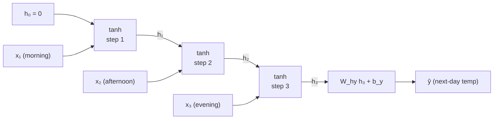
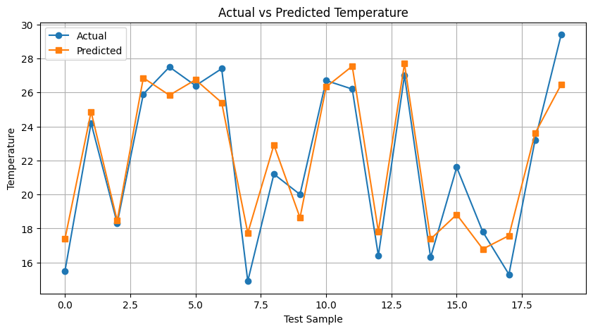

# Vanilla Recurrent Neural Network (from scratch)


A recurrent neural network (RNN) processes a sequence one element at a time while carrying a hidden state $h_t$ forward, so that each step can depend on everything seen before it. The same weights are reused at every timestep, which makes the parameter count independent of the sequence length. This module implements a vanilla RNN entirely in NumPy: the forward pass through time, the squared-error loss, backpropagation through time (BPTT), and a per-sample stochastic gradient descent (SGD) update. No deep-learning framework is used; scikit-learn is used only for the train/test split, scaling, and the MSE metric.

## Problem Statement

**Data:** `temp_vanilla.csv` holds one record per day with four columns: `temp_morning`, `temp_afternoon`, `temp_evening`, and the target `next_day_temp`. There are 100 days in total (80 train + 20 test).

**Task:** Regression: predict the next day's temperature from the three readings of the current day.

**Framing for the RNN:** The three readings are not flattened into one vector. They are consumed as a sequence of $T=3$ timesteps with a single scalar feature each ($d=1$), in the order morning → afternoon → evening. The prediction is read from the final hidden state $h_T$ only.

**Preprocessing**
- Split: `train_test_split(test_size=0.2, random_state=42)`.
- Scaling: `StandardScaler` for the inputs and a separate `StandardScaler` for the target, both fitted on the training set only and then applied to the test set. Each of the three input columns is standardised independently, so the scalar fed at step $t$ is the standardised value of that reading.
- Test predictions are mapped back to the original units with `y_scaler.inverse_transform` before computing the metric.

**Loss and metric:** Per-sample loss $L = \tfrac12\|\hat y - y\|^2$ on the standardised target during training. Evaluation uses MSE on the test set in original temperature units.

| Quantity | Shape |
|---|---|
| `X_train` | (80, 3), read as 3 timesteps × 1 feature |
| `y_train` | (80, 1) |
| `X_test` | (20, 3) |
| `y_test` | (20, 1) |
| Input at step $t$, $x_t$ | (1, 1) |
| Hidden state $h_t$ | (8, 1) |
| Output $\hat y$ | (1, 1) |

The dataset is small (80 training samples, 20 test samples), so the results below illustrate how the mechanism behaves and should not be read as evidence of strong generalisation.

## Architecture

### Unrolled structure



The same $W_{xh}, W_{hh}, b_h$ are used at all three steps. Only $h_T$ feeds the output layer.

### Hyperparameters and Parameters

| Setting | Value |
|---|---|
| Input size $d$ | 1 |
| Hidden size $h$ | 8 |
| Output size $k$ | 1 |
| Timesteps $T$ | 3 |
| Hidden activation | $\tanh$ |
| Output activation | identity (linear) |
| Initial state | $h_0 = 0$ |
| Weight init | $\mathcal{N}(0,1)\times 0.1$; biases zero |
| Optimiser | per-sample SGD (one update per training sample) |
| Learning rate $\eta$ | 0.001 |
| Epochs | 1000 |
| Random seed | not set (`np.random.seed` is commented out) |

| Parameter | Shape | Count |
|---|---|---|
| $W_{xh}$ | $h \times d = 8\times 1$ | 8 |
| $W_{hh}$ | $h \times h = 8\times 8$ | 64 |
| $b_h$ | $h \times 1 = 8\times 1$ | 8 |
| $W_{hy}$ | $k \times h = 1\times 8$ | 8 |
| $b_y$ | $k \times 1 = 1\times 1$ | 1 |
| **Total** | | **89** |

### Forward Pass

For $t = 1,\dots,T$ with $h_0 = 0$:

$$h_t = \tanh\!\left(W_{xh}\,x_t + W_{hh}\,h_{t-1} + b_h\right)$$

and after the last step:

$$\hat y = W_{hy}\,h_T + b_y$$

```python
h_prev = np.zeros((hidden_size, 1))
xs, hs = [], []

for t in range(T):
    x_t = np.array([[X_train[n, t]]])
    h_prev = np.tanh(Wxh @ x_t + Whh @ h_prev + bh)
    xs.append(x_t)
    hs.append(h_prev)

y_hat = Why @ hs[T-1] + by
```

### Loss

$$L = \tfrac12\,\|\hat y - y\|^2$$

```python
loss = 0.5 * np.sum((y_hat - target) ** 2)
```

### Backpropagation Through Time

Because the weights are shared across timesteps, the gradients of $W_{xh}$, $W_{hh}$ and $b_h$ are accumulated over all steps. The derivative of the activation is $\tanh'(z) = 1 - \tanh^2(z)$, which is $1 - h_t^2$ since $h_t = \tanh(\cdot)$.

**Output layer.** Only $h_T$ feeds the output:

$$\delta_y = \hat y - y,\qquad \frac{\partial L}{\partial W_{hy}} = \delta_y\, h_T^\top,\qquad \frac{\partial L}{\partial b_y} = \delta_y$$

**Starting the recursion.** The only path into $h_T$ is through the output layer:

$$\delta h_T = W_{hy}^\top\,\delta_y$$

**Backward over $t = T,\dots,1$:**

$$\delta z_t = \delta h_t \odot \left(1 - h_t^2\right)$$

$$\frac{\partial L}{\partial b_h} \mathrel{+}= \delta z_t,\qquad \frac{\partial L}{\partial W_{xh}} \mathrel{+}= \delta z_t\, x_t^\top,\qquad \frac{\partial L}{\partial W_{hh}} \mathrel{+}= \delta z_t\, h_{t-1}^\top \;\;(t>1)$$

$$\delta h_{t-1} = W_{hh}^\top\,\delta z_t$$

The $W_{hh}$ term is skipped at $t=1$ because $h_0 = 0$ is a fixed initial state, not a quantity that depends on a parameter. The last line carries the error one step further back, so the error at the output reaches $t=1$ and contributes to the shared-weight gradients at every step along the way.

```python
dy   = y_hat - target
dWhy = dy @ hs[T-1].T
dby  = dy

dWxh = np.zeros_like(Wxh); dWhh = np.zeros_like(Whh); dbh = np.zeros_like(bh)
dh_next = Why.T @ dy                      # δh_T

for t in reversed(range(3)):              # t = 2, 1, 0
    h  = hs[t]
    dh = dh_next
    da = dh * (1 - h**2)                  # δz_t

    dbh  += da
    dWxh += da @ xs[t].T
    if t > 0:
        dWhh += da @ hs[t-1].T

    dh_next = Whh.T @ da                  # δh_{t-1}
```

### Parameter Update

$$\theta \leftarrow \theta - \eta\,\frac{\partial L}{\partial \theta},\qquad \theta \in \{W_{xh},\,W_{hh},\,b_h,\,W_{hy},\,b_y\}$$

```python
Wxh -= learning_rate * dWxh
Whh -= learning_rate * dWhh
bh  -= learning_rate * dbh
Why -= learning_rate * dWhy
by  -= learning_rate * dby
```

The update runs once per training sample, so there are 80 updates per epoch.

## RESULTS

### Training loss

The value printed every 100 epochs is the average per-sample loss $\tfrac12\|\hat y - y\|^2$ over the training set, computed in the standardised target space.

| Epoch | Avg. training loss |
|---|---|
| 0 | 0.485936 |
| 100 | 0.045499 |
| 200 | 0.045478 |
| 300 | 0.045461 |
| 400 | 0.045447 |
| 500 | 0.045434 |
| 600 | 0.045422 |
| 700 | 0.045410 |
| 800 | 0.045399 |
| 900 | 0.045389 |

### Test performance

After training, the 20 held-out samples are passed through the network, the predictions are converted back to original units, and the MSE is computed against `y_test`.

| Metric | Value |
|---|---|
| Test MSE (original units) | 2.6444 |

### Actual vs predicted (test set)



### Interpretation

- The training loss drops sharply in the first 100 epochs (0.486 → 0.045) and then flattens, falling only in the fifth decimal place over the next 800 epochs. With $\eta = 0.001$ and per-sample updates, further training changes the fit very little.
- In the plot, the predictions follow the overall rise and fall of the actual values across the 20 test samples, but they tend to be pulled towards the middle of the range: some of the lowest actual values (e.g. samples 0 and 7) are over-predicted and the highest one (sample 19) is under-predicted.
- These numbers come from a single run on 20 test samples. The random seed is not fixed, so the initial weights, and therefore the exact loss values and test MSE, will differ slightly from run to run. The test MSE is a small-sample illustration of the mechanism rather than a precise estimate of generalisation error.
- The MLP and RNN modules use the same split and scaling, so their test errors are measured on the same 20 samples. The LSTM module uses sliding windows of days, so its test set is different and its error should not be compared directly with these.
