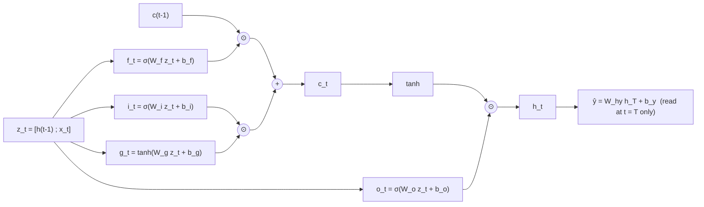
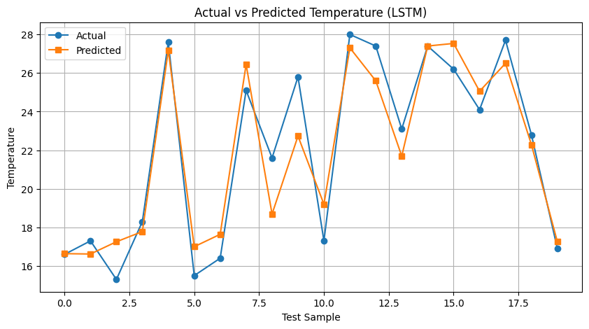

# LSTM from Scratch (NumPy)

A Long Short-Term Memory (LSTM) network is a recurrent network whose memory is split into a short-term hidden state $h_t$ and a long-term cell state $c_t$. Three sigmoid gates (forget, input, output) and a tanh candidate decide what is erased from, written to, and read out of the cell state at every timestep. This module implements a single-layer LSTM regressor entirely in NumPy: the forward pass through time, the squared-error loss, gated backpropagation through time (BPTT), and the per-sample SGD update, with no deep-learning framework involved. What sets it apart from a vanilla RNN is the cell-state path $c_{t-1} \to c_t$, which is updated additively and scaled only by the forget gate, so error can travel back across many timesteps without being repeatedly squashed through a nonlinearity.

---

## Problem Statement

**Data:** The same 100-day temperature table used in the MLP and RNN modules (`temp_vanilla.csv`). Each row holds one day's `temp_morning`, `temp_afternoon`, `temp_evening` and the `next_day_temp` target.

**Framing for LSTM:** Instead of treating one day's three readings as a sequence, each sample is a **sliding window of $T=5$ consecutive days**, and each day contributes a $d=3$ feature vector (morning, afternoon, evening). The target for a window is the `next_day_temp` of its last day, i.e. the temperature of the day immediately after the window ends.

```math
X^{(j)} = \big(r_j,\, r_{j+1},\, \dots,\, r_{j+T-1}\big), \qquad y^{(j)} = \text{next\_day\_temp}_{\,j+T-1}, \qquad r_j \in \mathbb{R}^{3}
```

```python
def build_sequences(features, targets, T):
    X_seq, y_seq = [], []
    for i in range(len(features) - T + 1):
        X_seq.append(features[i : i + T])
        y_seq.append(targets[i + T - 1])
    return np.array(X_seq), np.array(y_seq).reshape(-1, 1)
```

**Split and Scaling:**

- 100 days with window length 5 give $100 - 5 + 1 = 96$ windows.
- `train_test_split(test_size=0.2, random_state=42)` gives 76 training and 20 test windows. The split is random (shuffled).
- Features are standardised with `StandardScaler`, fitted on the training windows only (flattened to $(N\cdot T,\, 3)$ for fitting, then reshaped back). The target gets its own `StandardScaler`, also fitted on training data only.
- Predictions are inverse-transformed, so test MSE and MAE are reported in the original temperature units.

| Quantity | Shape | Samples |
|---|---|---|
| Input $X$ (all windows) | $(96,\, 5,\, 3)$ | 96 |
| Target $y$ (all windows) | $(96,\, 1)$ | 96 |
| Train $X$ / $y$ | $(76,\, 5,\, 3)$ / $(76,\, 1)$ | 76 |
| Test $X$ / $y$ | $(20,\, 5,\, 3)$ / $(20,\, 1)$ | 20 |

**Task and metrics:** Regression. The per-sample loss is

$$
L = \tfrac{1}{2}\,\lVert \hat y - y \rVert^2
$$

computed on the standardised target during training. Evaluation uses MSE and MAE on the test set in original units.

**Caveat on the split.** Windows slide by one day, so adjacent windows share four of their five days. A random split can put near-duplicate windows in both train and test. A chronological split would be a stricter test. With only 20 test windows, the metrics below are best read as an illustration of the mechanism, not as evidence of generalisation.

---

## Architecture

### Cell diagram



The cell is unrolled over $T=5$ days with $h_0 = c_0 = 0$ and the same weights reused at every step. The output is read from the final hidden state $h_T$ only.

### Hyperparameters and Parameters

| Item | Value |
|---|---|
| Input size $d$ | 3 |
| Hidden size $h$ | 16 |
| Output size $k$ | 1 (linear, regression) |
| Sequence length $T$ | 5 |
| Gate input $z_t = [h_{t-1};\,x_t]$ | $\mathbb{R}^{19\times 1}$ |
| $W_f, W_i, W_g, W_o$ | each $16 \times 19$ |
| $b_f, b_i, b_g, b_o$ | each $16 \times 1$ |
| $W_{hy}$, $b_y$ | $1 \times 16$, $1 \times 1$ |
| Total trainable parameters | $4(16\cdot 19 + 16) + 16 + 1 = 1297$ |
| Initialisation | weights $\sim \mathcal{N}(0,\,0.1^2)$ (`np.random.randn(...) * 0.1`), biases $0$ |
| Optimiser | plain SGD, one sample at a time, no shuffling between epochs |
| Learning rate $\eta$ | $0.001$ |
| Epochs | 1000 |
| Random seed | not fixed (`np.random.seed(42)` is commented out in the notebook) |

```python
Wf = np.random.randn(hidden_size, concat_size) * 0.1   # concat_size = h + d = 19
bf = np.zeros((hidden_size, 1))
# Wi, Wg, Wo, bi, bg, bo are initialised the same way
Why = np.random.randn(output_size, hidden_size) * 0.1
by  = np.zeros((output_size, 1))
```

### 1. Forward Pass

For $t = 1,\dots,T$:

$$
\begin{aligned}
z_t &= \begin{bmatrix} h_{t-1} \\ x_t \end{bmatrix} \\
f_t &= \sigma(W_f z_t + b_f) && \text{forget gate} \\
i_t &= \sigma(W_i z_t + b_i) && \text{input gate} \\
g_t &= \tanh(W_g z_t + b_g) && \text{candidate cell state} \\
o_t &= \sigma(W_o z_t + b_o) && \text{output gate} \\
c_t &= f_t \odot c_{t-1} + i_t \odot g_t && \text{cell state update} \\
h_t &= o_t \odot \tanh(c_t) && \text{hidden state}
\end{aligned}
$$

$$
\hat y = W_{hy}\, h_T + b_y
$$

```python
for t in range(T):
    x_t = X_train[n, t].reshape(-1, 1)
    z_t = np.vstack((hs[t], x_t))

    f_t = sigmoid(Wf @ z_t + bf)
    i_t = sigmoid(Wi @ z_t + bi)
    g_t = np.tanh(Wg @ z_t + bg)
    o_t = sigmoid(Wo @ z_t + bo)

    c_t = f_t * cs[t] + i_t * g_t
    h_t = o_t * np.tanh(c_t)

y_hat = Why @ hs[T] + by
```

### 2. Loss

$$
L = \tfrac{1}{2}\,\lVert \hat y - y \rVert^2
$$

```python
loss = 0.5 * np.sum((y_hat - target) ** 2)
```

### 3. Backpropagation Through Time (Gated)

**Output layer:** Only $h_T$ feeds the output, so

$$
\delta_y = \hat y - y, \qquad \frac{\partial L}{\partial W_{hy}} = \delta_y\, h_T^\top, \qquad \frac{\partial L}{\partial b_y} = \delta_y
$$

and the backward recursion starts from $\delta h_T = W_{hy}^\top \delta_y$ with $\delta c_T = 0$.

**Per timestep, for $t = T, \dots, 1$.** Using $\sigma'(a) = \sigma(a)(1-\sigma(a))$ and $\tanh'(a) = 1 - \tanh^2(a)$:

$$
\begin{aligned}
\delta o_t &= \delta h_t \odot \tanh(c_t), & \delta o_t^{\text{raw}} &= \delta o_t \odot o_t \odot (1 - o_t) \\
\delta c_t &\mathrel{+}= \delta h_t \odot o_t \odot \big(1 - \tanh^2(c_t)\big) \\
\delta f_t &= \delta c_t \odot c_{t-1}, & \delta f_t^{\text{raw}} &= \delta f_t \odot f_t \odot (1 - f_t) \\
\delta i_t &= \delta c_t \odot g_t, & \delta i_t^{\text{raw}} &= \delta i_t \odot i_t \odot (1 - i_t) \\
\delta g_t &= \delta c_t \odot i_t, & \delta g_t^{\text{raw}} &= \delta g_t \odot (1 - g_t^2)
\end{aligned}
$$

Each gate accumulates into its own shared weight and bias gradients across all $T$ steps ($\bullet \in \{f, i, g, o\}$):

$$
\frac{\partial L}{\partial W_\bullet} \mathrel{+}= \delta_\bullet^{\text{raw}}\, z_t^\top, \qquad \frac{\partial L}{\partial b_\bullet} \mathrel{+}= \delta_\bullet^{\text{raw}}
$$

**Carrying error to $t-1$.** The gradient through the concatenated input is

$$
\delta z_t = W_f^\top \delta f_t^{\text{raw}} + W_i^\top \delta i_t^{\text{raw}} + W_g^\top \delta g_t^{\text{raw}} + W_o^\top \delta o_t^{\text{raw}}
$$

Its first $h$ entries flow into the hidden state, and the cell-state error is passed back through the forget gate:

$$
\delta h_{t-1} = \delta z_t[0{:}h], \qquad \boxed{\delta c_{t-1} = \delta c_t \odot f_t}
$$

The last $d$ entries of $\delta z_t$ are the gradient with respect to the input $x_t$, which is not trainable and is unused.

The boxed $\delta c$ path is the cell-state route for error: it is multiplied only by the forget gate $f_t$ at each step, with no extra tanh-derivative factor. The $\delta h$ path, as in a vanilla RNN, passes through the gate nonlinearities and the recurrent weights.

```python
dh_next = Why.T @ dy                  # δh_T
dc_next = np.zeros((hidden_size, 1))  # δc_T

for t in reversed(range(T)):
    h_t, c_t, c_prev_t = hs[t + 1], cs[t + 1], cs[t]
    f_t, i_t, g_t, o_t = fs[t], iis[t], gs[t], os_[t]
    dh = dh_next

    do     = dh * np.tanh(c_t)
    do_raw = do * o_t * (1 - o_t)

    dc     = dc_next + dh * o_t * (1 - np.tanh(c_t) ** 2)

    df_raw = (dc * c_prev_t) * f_t * (1 - f_t)
    di_raw = (dc * g_t)      * i_t * (1 - i_t)
    dg_raw = (dc * i_t)      * (1 - g_t ** 2)

    dWf += df_raw @ z_t.T; dbf += df_raw     # same pattern for i, g, o

    dz = (Wf.T @ df_raw + Wi.T @ di_raw +
          Wg.T @ dg_raw + Wo.T @ do_raw)

    dh_next = dz[:hidden_size, :]            # δh_{t-1}
    dc_next = dc * f_t                       # δc_{t-1}
```

### 4. Parameter Update

$$
\theta \leftarrow \theta - \eta\,\frac{\partial L}{\partial \theta}, \qquad \theta \in \{W_f, b_f, W_i, b_i, W_g, b_g, W_o, b_o, W_{hy}, b_y\}
$$

```python
Wf -= learning_rate * dWf; bf -= learning_rate * dbf
Wi -= learning_rate * dWi; bi -= learning_rate * dbi
Wg -= learning_rate * dWg; bg -= learning_rate * dbg
Wo -= learning_rate * dWo; bo -= learning_rate * dbo
Why -= learning_rate * dWhy
by  -= learning_rate * dby
```

The update runs once per training window, so 76 times per epoch.

---

## RESULTS

### Training loss

Printed every 100 epochs. The value is the average per-sample loss $\tfrac12(\hat y - y)^2$ on the **standardised** target, so it is not in temperature units.

| Epoch | Avg. training loss |
|---:|---:|
| 0 | 0.490322 |
| 100 | 0.042600 |
| 200 | 0.041946 |
| 300 | 0.041465 |
| 400 | 0.041100 |
| 500 | 0.040818 |
| 600 | 0.040597 |
| 700 | 0.040421 |
| 800 | 0.040278 |
| 900 | 0.040160 |

The loss falls sharply within the first 100 epochs and then declines slowly. By epoch 900 it is changing in the fourth decimal place per 100 epochs.

### Test metrics (original temperature units, 20 test windows)

| Metric | Value |
|---|---:|
| MSE | 2.1026 |
| MAE | 1.1921 |

### Actual vs Predicted



The test targets span roughly 15 to 28 in the plot. The predicted curve follows the general rise and fall of the actual curve, and several points are close (for example test samples 0, 3, 4, 11, 14, 18, 19). The largest misses are on some peaks and troughs, where the prediction is noticeably off (for example samples 7, 8, 10, 13 and 17).

### Interpretation and Limits

- Only 96 overlapping windows are available, and 20 of them make up the test set. A few individual points can move MSE and MAE noticeably, so the numbers should be taken as an illustration that the from-scratch LSTM trains and produces sensible predictions, not as a claim of strong generalisation.
- The split is random over overlapping windows, so some test windows share most of their days with training windows. This likely makes the test problem easier than a chronological split would.
- The random seed is not fixed, so a re-run will give somewhat different weights, loss values and test metrics.
- The test set here consists of $T=5$ windows and differs from the MLP and RNN test sets, which use single-day samples. The MSE and MAE above are therefore not directly comparable with those modules.
