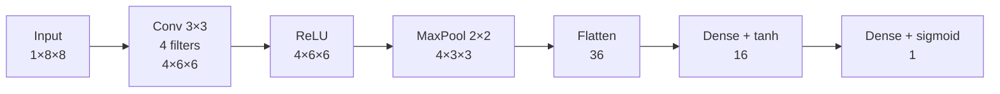
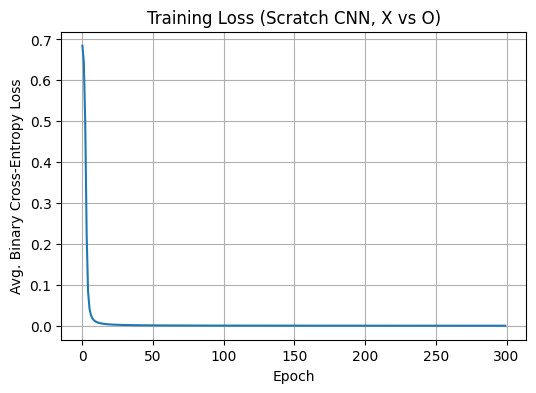
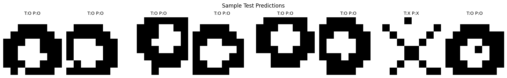

# Convolutional Neural Network from Scratch (NumPy)

This module implements a small convolutional neural network entirely in NumPy: convolution, ReLU, max pooling, flatten, two dense layers, binary cross-entropy loss, hand-written backpropagation and plain SGD. No deep-learning framework is used; scikit-learn appears only for the train/test split and the evaluation metrics.

What sets a CNN apart from the MLP is that it works on the 2D structure of an image. A small set of learnable filters is slid across the whole image, so the same few weights are reused at every position and max pooling adds tolerance to small shifts. The network here classifies 8×8 binary images as "X" or "O".

The notebook [`CNN.ipynb`](CNN.ipynb) explains the Math that goes behind (convolution, pooling, the loss, each step of backpropagation, the update rule) with the code that implements it.

## TASK

Binary image classification, "X" (label 1) versus "O" (label 0).

**Dataset:** no external dataset is used. The notebook generates 300 synthetic images, 150 per class, with a fixed random state (42). Each image is a single-channel 8×8 grid of 0/1 pixels:

- an **X** is two diagonal lines running corner to corner,
- an **O** is a thick ring around the centre,
- every image gets a random shift of −1, 0 or +1 pixels in each direction and 2 randomly flipped pixels, so the network does not simply see two fixed templates.

**Split:** 80/20, stratified, giving 240 training and 60 test images. The pixels are already binary, so no scaling is applied.

| | Shape | Samples |
|---|---|---|
| Image $x$ | $(C,H,W) = (1, 8, 8)$ | 240 train / 60 test |
| Label $y$ | scalar in $\{0,1\}$ | 120 X + 120 O train / 30 X + 30 O test |

**Loss and metric:** binary cross-entropy for training; accuracy and the confusion matrix for evaluation.

## Architecture of a Convolutional Neural Network



| Component | Setting |
|---|---|
| Convolution | $F=4$ filters, $K=3$, stride 1, no padding |
| Pooling | max, $2\times2$, stride 2 |
| Dense hidden layer | 16 neurons, tanh |
| Output | 1 neuron, sigmoid (probability of "X") |
| Loss | binary cross-entropy |
| Optimiser | online SGD (one image per update), $\eta = 0.01$ |
| Epochs | 300 |
| Initialisation | weights $0.1\times\mathcal{N}(0,1)$, biases zero |

| Layer | Parameters |
|---|---|
| Conv ($W_c$, $b_c$) | 40 |
| Dense 1 ($W_{d1}$, $b_{d1}$) | 592 |
| Dense 2 ($W_{d2}$, $b_{d2}$) | 17 |
| **Total** | **649** |


## Results

### Training log

Average binary cross-entropy per epoch, printed every 20 epochs:

```
Epoch    0   Loss = 0.684650
Epoch   20   Loss = 0.003147
Epoch   40   Loss = 0.001267
Epoch   60   Loss = 0.000774
Epoch   80   Loss = 0.000552
Epoch  100   Loss = 0.000426
Epoch  120   Loss = 0.000346
Epoch  140   Loss = 0.000291
Epoch  160   Loss = 0.000250
Epoch  180   Loss = 0.000219
Epoch  200   Loss = 0.000195
Epoch  220   Loss = 0.000175
Epoch  240   Loss = 0.000159
Epoch  260   Loss = 0.000146
Epoch  280   Loss = 0.000135
```

The epoch-0 loss of about 0.68 is close to $\ln 2 \approx 0.693$, which is what a network guessing 50/50 would score. The loss then falls almost to zero within the first 20 epochs.



The curve drops so quickly that only the initial fall is visible at this scale. The slow decline afterwards is visible in the log above.

### Test performance

```
Test Accuracy : 100.00%
Confusion matrix (rows=actual, cols=predicted; 0=O, 1=X):
[[30  0]
 [ 0 30]]
```

All 60 test images are classified correctly. The figure shows the first 8 test images with their true (T) and predicted (P) labels; this is simply the first 8 in the test set, so most happen to be O.



