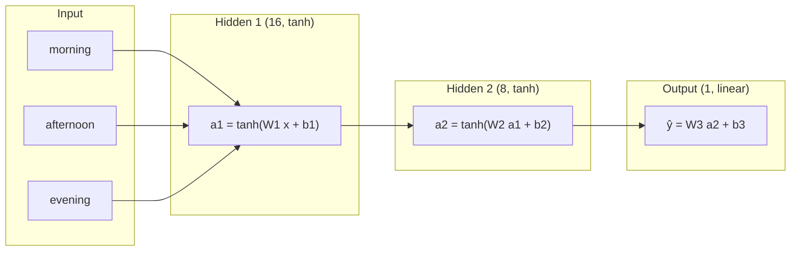

# MULTILAYER PERCEPTRON (MLP)

A Multilayer Perceptron is a feed-forward network: a stack of fully connected layers with non-linear activations in between, mapping a fixed-size input vector to an output in a single pass. This module implements a 3 → 16 → 8 → 1 MLP entirely in NumPy: the forward pass, the loss, backpropagation derived by hand with the chain rule and a plain stochastic gradient descent (SGD) update. scikit-learn is used only for the train/test split, the scaling and the metrics. What distinguishes the MLP is that it is a **static mapping**: each input is processed independently, with no state carried from one sample to the next and no notion of order within the input.

## PROBLEM STATEMENT

**TASK** 
Predict the next day's temperature from today's three readings. This is a regression problem.

**DATASET** 
`temp_vanilla.csv` contains 100 consecutive days. Each row has `temp_morning`, `temp_afternoon`, `temp_evening` (the inputs) and `next_day_temp` (the target).

**PROBLEM FRAMING** 
Each day's three readings form one flat vector $x \in \mathbb{R}^{3\times 1}$ ($d=3$). Rows are treated as independent samples, so the network has no notion of the order morning → afternoon → evening. It maps the vector directly to a single output ($k=1$).

**Split and scaling:**

- 80/20 train/test split with `random_state=42`, giving 80 training and 20 test samples. The split is random, so test samples are not consecutive days.
- Inputs and targets are both standardised (zero mean, unit variance). The scalers are fitted on the training data only and then applied to the test data.
- Predictions are mapped back to original temperature units with `y_scaler.inverse_transform` before the metrics are computed.

| | Shape (train) | Shape (test) |
|---|---|---|
| Input $X$ | $(80, 3)$ | $(20, 3)$ |
| Target $y$ | $(80, 1)$ | $(20, 1)$ |

**Loss and metrics:** Training minimises the per-sample squared error

$$
L = \tfrac{1}{2}\,\lVert \hat{y} - y \rVert^2 .
$$

Evaluation uses MSE and MAE, both computed in original temperature units.

## ARCHITECTURE



| Layer | Weights | Biases | Parameters |
|---|---|---|---|
| Input → Hidden 1 | $W_1 \in \mathbb{R}^{16\times 3}$ | $b_1 \in \mathbb{R}^{16}$ | 64 |
| Hidden 1 → Hidden 2 | $W_2 \in \mathbb{R}^{8\times 16}$ | $b_2 \in \mathbb{R}^{8}$ | 136 |
| Hidden 2 → Output | $W_3 \in \mathbb{R}^{1\times 8}$ | $b_3 \in \mathbb{R}^{1}$ | 9 |
| **Total** | | | **209** |

Design choices:

- **tanh in the hidden layers.** It is smooth, zero-centred and bounded, and its derivative is cheap to compute from the output itself: $\tanh'(z) = 1 - \tanh^2(z) = 1 - a^2$.
- **Linear output.** The target is a continuous, unbounded quantity, so no squashing function is applied to $\hat{y}$.
- **Small random initialisation.** Weights are drawn as $0.1 \times \mathcal{N}(0,1)$ (standard deviation 0.1) and biases start at zero. This keeps the pre-activations small so tanh starts in its near-linear region instead of saturating.

## RESULTS

### Training loss

The printed value is the mean per-sample loss $\tfrac12(\hat y - y)^2$ over the epoch, in **standardised** target units. The loss is accumulated while the weights are being updated, so it is a running average over the epoch rather than a loss measured with the final weights.

```
Epoch    0   Loss = 0.486159
Epoch  100   Loss = 0.045591
Epoch  200   Loss = 0.045471
Epoch  300   Loss = 0.045366
Epoch  400   Loss = 0.045270
Epoch  500   Loss = 0.045180
Epoch  600   Loss = 0.045093
Epoch  700   Loss = 0.045009
Epoch  800   Loss = 0.044927
Epoch  900   Loss = 0.044846
```

The loss falls sharply in the first 100 epochs and then decreases very slowly, from 0.0456 to 0.0448 over the remaining 800 epochs. A mean loss of about 0.045 corresponds to a standardised MSE of about 0.09 on the training data.

### Test metrics (original temperature units, 20 held-out samples)

| Metric | Test |
|---|---|
| MSE | 2.6861 |
| MAE | 1.4005 |

Train MSE/MAE in original units are not printed by the notebook, so they are not reported here.

### Actual vs predicted


The x-axis is the test-sample index. Because the split is random, neighbouring points are not consecutive days, so the connecting lines are only a visual aid.

### Interpretation

On the 20 test samples the predictions follow the actual values reasonably closely, with an average miss of about 1.4 temperature units. The largest gaps appear at a few points, for example the final test sample, where the prediction is roughly 3 units below the actual value. These results come from a single run on a very small dataset (80 training and 20 test samples).
