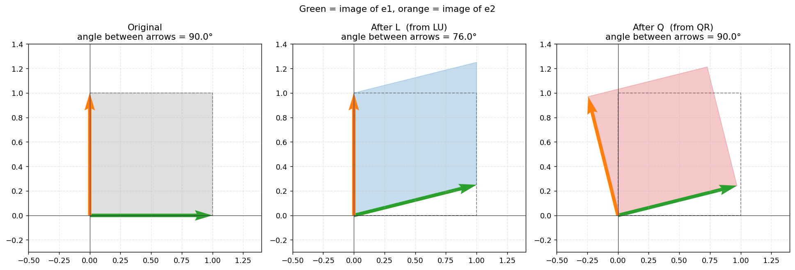

# LU vs QR: what a decomposition does to space

A 2×2 matrix is a move of the plane. It takes the two basis arrows $e_1 = (1,0)$ and $e_2 = (0,1)$, which meet at a right angle, and sends them somewhere new. Everything else in the plane follows, because every vector is just a mix of those two arrows.

Decomposing a matrix means cutting that one move into two simpler moves. LU and QR both do this, but they cut in different places, and that difference shows up as soon as you watch what happens to the angle between $e_1$ and $e_2$. This module does exactly that, on the matrix

$$A = \begin{bmatrix}4 & 2\\ 1 & 3\end{bmatrix}.$$

The notebook (`LUvsQR.ipynb`) factors $A$ both ways, checks the factorisations and plots the unit square before and after each factor.

## LU: Gaussian elimination, with the receipts kept

To solve a system by hand we clear the entry below the top-left pivot: here, subtract $\tfrac14$ of row 1 from row 2. What is left is an upper triangular matrix $U$. LU decomposition simply keeps the multiplier you used, $\tfrac14$, in a matrix $L$, so that $A = LU$ and nothing is thrown away.

```python
def lu_decomposition(A):
    n = A.shape[0]
    U = A.astype(float).copy()
    L = np.eye(n)
    for col in range(n):
        pivot = U[col, col]
        assert abs(pivot) > 1e-12, "Zero pivot: this simple version does not swap rows."
        for row in range(col + 1, n):
            factor = U[row, col] / pivot        # the multiplier
            L[row, col] = factor                # store it in L
            U[row, :] -= factor * U[col, :]     # eliminate the entry
    return L, U
```

```
L =                 U =
[[1.   0.  ]        [[4.  2. ]
 [0.25 1.  ]]        [0.  2.5]]
```

Geometrically, "subtract a multiple of one row from another" is a **shear**: one direction slides sideways in proportion to another, like pushing the top of a deck of cards. A shear keeps areas the same (so $\det L = 1$, and all the area scaling of $A$ sits in $U$) but it does not keep shapes: a square slides into a parallelogram.

## QR: keep only what is new

Gram–Schmidt builds an orthonormal pair of directions out of the columns of $A$. The first column is just rescaled to length 1. For the second column, subtract the part that already points along the first direction, and rescale what is left to length 1. What you subtracted and the lengths you divided by go into $R$.

```python
def qr_decomposition(A):
    n, m = A.shape
    Q = np.zeros((n, m))
    R = np.zeros((m, m))
    for j in range(m):
        v = A[:, j].astype(float).copy()
        for i in range(j):
            R[i, j] = Q[:, i] @ A[:, j]     # how much of q_i is in this column
            v -= R[i, j] * Q[:, i]          # remove it
        R[j, j] = np.linalg.norm(v)         # what is left
        Q[:, j] = v / R[j, j]               # make it unit length
    return Q, R
```

```
Q =                     R =
[[ 0.97  -0.243]        [[4.123 2.668]
 [ 0.243  0.97 ]]        [0.    2.425]]
```

The columns of $Q$ are unit vectors at right angles to each other ($Q^\top Q = I$), so $Q$ is a rotation: it can turn the plane but cannot stretch or tilt it. The notebook confirms that $LU$ and $QR$ both rebuild $A$ exactly and that $Q^\top Q = I$.

## The angle

Take the unit square spanned by $e_1$ and $e_2$ and push it through a factor. The two arrows (green for $e_1$, orange for $e_2$) show where the basis vectors land, and the shaded shape is where the square lands. The dashed outline is the original.



After $L$ the square has been slid into a parallelogram and the angle between the arrows has dropped from 90° to 76°. After $Q$ the square has only rotated; it is still a square, and the angle is still 90°. Lengths are preserved as well, which is why the rotated square is the same size as the original.

## Not just L

It would be easy to leave this picture with the idea that $L$ is the only troublemaker. Measuring the angle between the images of $e_1$ and $e_2$ for all four factors:

```
Angle between the images of e1 and e2 (originally 90°):

  L:  75.96°
  U:  51.34°
  Q:  90.00°
  R:  42.27°
```

$U$ changes the angle even more than $L$ does. So LU cuts $A$ into two moves that both bend space: a shear $L$ and a stretch-and-shear $U$, neither of which is rigid. QR cuts $A$ into one rigid move, $Q$, followed by one that does all the bending, $R$. Because $Q$ cannot change any lengths or angles, everything that $A$ does to shapes is concentrated in $R$ (you can check that $R$ and $A$ stretch the plane by exactly the same amounts), and the orthogonal part is cleanly separated out.

## Running 

```bash
pip install numpy matplotlib
jupyter notebook LUvsQR.ipynb
```

Edit the four entries of `A` in the second cell to try other matrices. The matrix needs to be 2×2, invertible, and have a non-zero top-left entry, since the LU routine does not swap rows. The QR routine is the classical Gram–Schmidt version, which is fine for a small, well-behaved example like this one.
